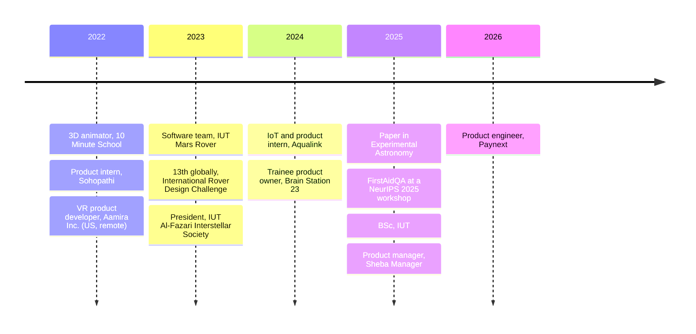

<!-- Md. Mushfiqur Rahman Mushfique, github.com/i-am-mushfiq -->

# Md. Mushfiqur Rahman Mushfique

Product Engineer at Paynext

 

[Paynext](https://paynext.com.bd) is building merchant payment infrastructure for Bangladesh. 
Before joining, I was a product manager at Sheba Manager and ran its Online Store and Due Tracker ledger. 
I've co-authored two machine learning papers, and my undergraduate thesis adapted Gaussian Splatting to CT data.

BSc Software Engineering, Islamic University of Technology (2025) &nbsp;·&nbsp; Dhaka, Bangladesh

 

 

<table>
<tr>
<td align="center" width="25%" valign="top">
<a href="#sheba-manager"><b>18K MAU</b></a> 
Due Tracker, the most-used feature on Sheba Manager
</td>
<td align="center" width="25%" valign="top">
<a href="#research"><b>Q2 journal</b></a> 
<i>Experimental Astronomy</i>, 2025
</td>
<td align="center" width="25%" valign="top">
<a href="#research"><b>NeurIPS 2025 workshop</b></a> 
FirstAidQA, 2,300+ dataset downloads
</td>
<td align="center" width="25%" valign="top">
<a href="#robotics-and-leadership"><b>13th globally</b></a> 
International Rover Design Challenge 2023
</td>
</tr>
</table>

<a href="#timeline">Timeline</a> &nbsp;·&nbsp;
<a href="#work">Work</a> &nbsp;·&nbsp;
<a href="#research">Research</a> &nbsp;·&nbsp;
<a href="#robotics-and-leadership">Robotics</a> &nbsp;·&nbsp;
<a href="#projects">Projects</a> &nbsp;·&nbsp;
<a href="#exploring-now">Exploring now</a> &nbsp;·&nbsp;
<a href="#toolkit">Toolkit</a> &nbsp;·&nbsp;
<a href="#contact">Contact</a>

 

## Timeline

On GitHub you can zoom and pan the diagram.

 

## Work

### Paynext

**Product Engineer**

The platform is designed for regulated PSO and WLAMA payment operations. It covers online checkout, routing across several acquiring banks, in-store QR and POS payments, settlement and reconciliation, and a merchant back office called Merchant OS. Paynext is currently onboarding merchants through early access.

<b>What the Paynext platform includes</b>

 

| Product | What it does |
| --- | --- |
| Payment Gateway | Online checkout, payment links, card and wallet acceptance, tokenized payments, checkout APIs |
| Smart Routing | Routing across acquirers by ONUS/OFFUS, MCC, BIN and issuer rules, with failover |
| POS and Speaker POS | In-store QR and card payments with Bangla voice confirmation and fake-payment protection |
| Bangla QR | Merchant QR acceptance, activation and transaction monitoring |
| Escrow | Held payments with milestone release and dispute-linked settlement |
| EMI and BNPL | Bank-led instalments, QR EMI and merchant-funded offers |
| Tokenization | Card-on-file and recurring payments |
| Merchant OS | Settlements, reconciliation, refunds, disputes and analytics in one dashboard |

Source: [paynext.com.bd](https://paynext.com.bd) · [Paynext on LinkedIn](https://www.linkedin.com/company/paynextbd)

### Sheba Manager

**Product Manager, MTO track** · October 2025 to March 2026

Sheba Manager (sManager) was a pocket ERP used by thousands of small retailers across Bangladesh, with Sheba Pay as its wallet. I owned the Online Store and Due Tracker products and ran bug triage for the platform. The program ended when the company entered insolvency.

<table>
<tr>
<td align="center" width="25%" valign="top"><b>44 defects</b> high impact, fixed in two release cycles, from a backlog of 114 bugs</td>
<td align="center" width="25%" valign="top"><b>18K MAU</b> on Due Tracker; platform MAU went from 40K to 45K</td>
<td align="center" width="25%" valign="top"><b>3 steps</b> for POS checkout, down from 7, after field observation</td>
<td align="center" width="25%" valign="top"><b>−40%</b> task time in merchant usability tests; UI support tickets −50%</td>
</tr>
</table>

- Due Tracker was a peer-to-peer ledger for tracking dues, integrated with Sheba Pay. I started by interviewing merchants with low digital literacy and wrote the SRS, PRDs and user stories from what they told me. With engineering I designed a leader-based consensus mechanism for the shared ledger state, covering state transitions, conflict resolution and the API contracts for settlement. It became the most-used feature on the platform.
- The platform had 114 documented bugs when I arrived. I scored each by severity and frequency, and we stopped shipping releases with any major bug open. The team fixed 44 high-impact defects within two release cycles, and critical incidents fell by more than half.
- The Online Store was a Shopify-style storefront for retailers, with a catalog of 500+ SKUs. I shipped inventory sync, order and transaction flows, and third-party API integrations. I discussed roadmap trade-offs with the CEO and CTO every day. Monthly active users grew by 5,000+. During a security review of the storefront I found refresh tokens and user data exposed on the frontend.
- Merchants tested Figma prototypes of the Sheba Pay home, POS and inventory screens in the field. After watching them use the prototypes, I cut checkout from seven steps to three. Task-completion time dropped 40% and UI-related support tickets dropped 50%.

<b>More from Sheba Manager</b>

 

- Sheba Manager ran on top of the Sheba Pay wallet, so a new merchant went through two apps' worth of setup. I worked with Legal on which steps Bangladesh Bank rules required and scoped a shorter flow. The company wound down before it was built.
- I ran API tests across Sheba Manager, Sheba Pay and external systems.
- I compared our UI with five other MSME tools, and checked homepage banner space against conversion before changing the layout.
- Platform GTV went from about 8 to 12 crore BDT (roughly $0.7M to $1.0M) over this period.[^gtv]
- I onboarded a QA engineer and mentored seven interns across product and QA. My bug list became the team's reference for triage and sprint planning.
- Marketing, Customer Success and I prepared launch material, merchant training and release notes together.

&nbsp;&nbsp;

### Earlier work

<table>
<tr>
<td width="30%" align="center" valign="middle">

</td>
<td width="70%" valign="top">

**Aqualink** · IoT and Product Intern · June to July 2024

I worked on a greenhouse automation dashboard for Sher-e-Bangla Agricultural University. Agronomists gave me their requirements, and I prototyped a single control interface for mobile and desktop in Figma. Manual climate-control time fell 30%. I also tested edge-ML anomaly detection on microcontrollers; the engineering team adopted the predictive-maintenance plan I recommended from the results.

</td>
</tr>
<tr>
<td width="30%" align="center" valign="middle">

</td>
<td width="70%" valign="top">

**Brain Station 23** · Trainee Product Owner · July to October 2024

I was product owner for a commercial game prototype, working in three-week sprints. I kept the Jira backlog, wrote acceptance criteria, ran sprint planning, and demoed progress to stakeholders every two weeks.

</td>
</tr>
</table>

<b>2022 and 2023</b>

 

- **Aamira Inc. (US, remote)** · VR Product Developer · 2022 to 2023. With a US university professor, I built educational VR games for kindergarten children. They taught temperature, gas volume and reading an analog clock to users with limited motor skills and no experience with technology.
- **Sohopathi** · Product and Analytics Intern · 2022. I won the internship through a competition, then compared the funnels, features and pricing of four EdTech competitors. My one-page channel-mix recommendation to leadership improved lead quality.
- **10 Minute School** · 3D Animator · 2022. I animated assets for Bangladesh's largest EdTech platform and led character design for *Math Monsters*.

<a href="#md-mushfiqur-rahman-mushfique">Back to top</a>

## Research

<table>
<tr>
<td width="50%" valign="top">

**Asteroid family classification with machine learning: investigative analysis of a novel two-step approach for categorizing known small asteroid families**

[*Experimental Astronomy* 59(1), 2025](https://doi.org/10.1007/s10686-025-09982-y) · Q2

A two-step pipeline, XGBoost followed by Random Forest, for assigning asteroids to families. The paper compares four techniques for handling class imbalance.

</td>
<td width="50%" valign="top">

**FirstAidQA: A Synthetic Dataset for First Aid and Emergency Response in Low-Connectivity Settings**

[MusIML Workshop at NeurIPS 2025](https://arxiv.org/abs/2511.01289)

5,500 human-validated question-answer pairs for fine-tuning small language models that run offline. The dataset has been downloaded more than 2,300 times on Hugging Face.[^downloads]

[Paper](https://arxiv.org/abs/2511.01289) · [Dataset](https://huggingface.co/datasets/i-am-mushfiq/FirstAidQA) · [Fine-tuning code](https://github.com/i-am-mushfiq/FirstAidQA-gemma2b-QLoRA)

</td>
</tr>
</table>

<b>Follow-up: what quantization did to Gemma 2B</b>

 

In the [fine-tuning repository](https://github.com/i-am-mushfiq/FirstAidQA-gemma2b-QLoRA) I compared 4-bit, 8-bit and FP16 QLoRA configurations of Gemma 2B Instruct on FirstAidQA and tested each emergency scenario separately. The 8-bit model consistently gave dangerous advice about how to position a patient, and its aggregate accuracy score gave no sign of it. We dropped the 8-bit configuration because of that result.

<table>
<tr>
<td>

**Orthographic Gaussian Splatting from CT Radiographs** · IUT, 2025

Gaussian Splatting was designed for perspective cameras, but CT slices are parallel projections with fixed spacing between them. My thesis adapts Gaussian Splatting to orthographic projection geometry and applies it to clinical CT sequences.

Code: [3dgs-brain-ct-visualisation](https://github.com/i-am-mushfiq/3dgs-brain-ct-visualisation) &nbsp;·&nbsp; [sparse-view-gaussian-tomography](https://github.com/i-am-mushfiq/sparse-view-gaussian-tomography)

</td>
</tr>
</table>

<a href="#md-mushfiqur-rahman-mushfique">Back to top</a>

## Robotics and leadership

<table>
<tr>
<td width="32%" align="center" valign="middle">

</td>
<td width="68%" valign="top">

**IUT Mars Rover (Project Altair)** · Senior Executive, Software Team · 2023

The team placed 13th globally at the International Rover Design Challenge in Coimbatore, run by the Space Robotics Society.

I led software for the rover: autonomy, telemetry, computer vision, and the interface between software and hardware. The code had to run within a limited power budget, tolerate communication delay and noisy sensors, respond in real time, and recover from failures in the field.

STACK&nbsp; ROS · C++ · Python · Embedded Linux · OpenCV · State machines

</td>
</tr>
</table>

<b>Other roles and awards</b>

 

| Year | |
| --- | --- |
| 2023 | President, IUT Al-Fazari Interstellar Society |
| 2023 | Head of Software and Automation, IUT Automobile Society |
| 2023 | Finalist, A2I Rocketry |
| 2022 | Champion, INTERN Business Case Competition (IUT Career and Business Society) |
| 2022 | Runner-up, Line Following and Obstacle Avoiding Robot Competition |
| 2021 | Runner-up, Renewable Energy Innovation Challenge (SREDA and GIZ Germany) |
| | Champion, Satellite Expedition Contest (BRAC IEEE and AESS) |

<a href="#md-mushfiqur-rahman-mushfique">Back to top</a>

## Projects

<table>
<tr>
<td width="50%" valign="top">

**[Deckwise](https://deckwise.vercel.app)** · Founder

A flashcard app with spaced repetition and a Llama 3.3 70B integration through Groq. It is offline-first and uses Google sign-in. I ran a structured alpha test with early users.

[Live app](https://deckwise.vercel.app) · [Code](https://github.com/i-am-mushfiq/Deckwise)

</td>
<td width="50%" valign="top">

**Annual-report Q&A** · Solo build

A retrieval system for questions about the annual reports of companies on the Bangladesh stock exchange. It runs as nine services built with FastAPI, Celery and Weaviate, orchestrated with Docker Compose. I built it alone in about a week with AI coding agents.

</td>
</tr>
<tr>
<td width="50%" valign="top">

**[GPS Visualizer](https://github.com/i-am-mushfiq/gps-visualizer)**

A 3D model of the GPS constellation that shows trilateration step by step. Three.js with custom GLSL shaders and a Keplerian orbit propagator written from scratch.

</td>
<td width="50%" valign="top">

**[FlashDown](https://github.com/i-am-mushfiq/FlashDown)**

A Markdown viewer for Windows written in C++17 and Win32. It ships as one small executable with no runtime dependencies and opens files almost instantly.

</td>
</tr>
</table>

<a href="#md-mushfiqur-rahman-mushfique">Back to top</a>

## Exploring now

 &nbsp;Neither of these is published or finished.

- Reinforcement learning for spacecraft proximity operations, using Clohessy-Wiltshire dynamics, control barrier functions and Soft Actor-Critic. I want to know whether a learned policy can stay inside hard physical and safety limits and still be useful under realistic dynamics. The code is in [Docking_research](https://github.com/i-am-mushfiq/Docking_research).
- Mechanistic interpretability: methods for explaining why a transformer model produces a particular behavior.

<a href="#md-mushfiqur-rahman-mushfique">Back to top</a>

## Toolkit

| Area | Tools and methods |
| --- | --- |
| Product | PRDs, SRS, user stories, Jira, Figma prototyping and usability testing, funnel analysis |
| Payments | Transaction state machines, ledger consensus, settlement API contracts, reconciliation, security review |
| Engineering | Python, C++, C, C#, JavaScript, React/Next.js, FastAPI, Celery, Docker, Firebase, MongoDB, Supabase |
| Machine learning | PyTorch, Hugging Face, QLoRA, scikit-learn, XGBoost, Weaviate |
| Vision and 3D | OpenCV, 3D Gaussian Splatting, neural rendering, medical imaging |
| Robotics and embedded | ROS/ROS2, FreeRTOS, Embedded Linux, ARM Cortex, CUDA |
| Graphics and XR | Unity, Meta XR SDK, WebGL, Three.js, GLSL |
| Science | Astrodynamics, orbital mechanics, Clohessy-Wiltshire dynamics |

 

## Contact

I'm open to research collaborations and work on financial infrastructure.

&nbsp;

Dhaka, Bangladesh &nbsp;·&nbsp; English (IELTS 8.0) &nbsp;·&nbsp; Bengali (native)

I don't show GitHub stats here. The repositories show what I'm working on. 
<a href="#md-mushfiqur-rahman-mushfique">Back to top</a>

[^gtv]: This is the figure for all of Sheba Manager. The products I owned were one part of it.
[^downloads]: Hugging Face all-time count, checked in October 2026.
